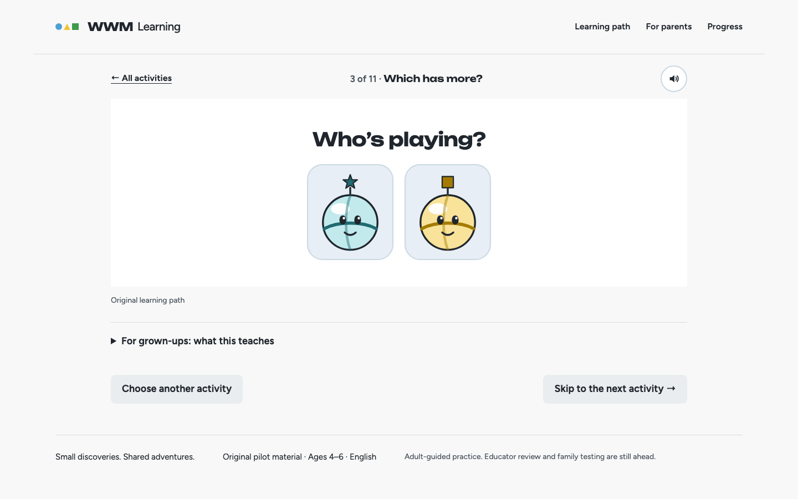
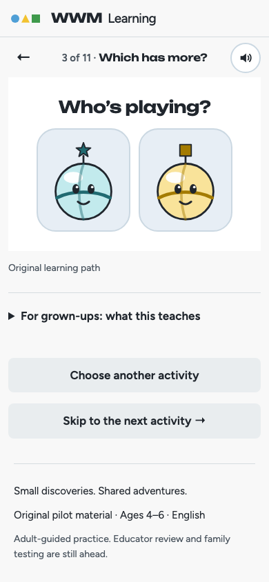
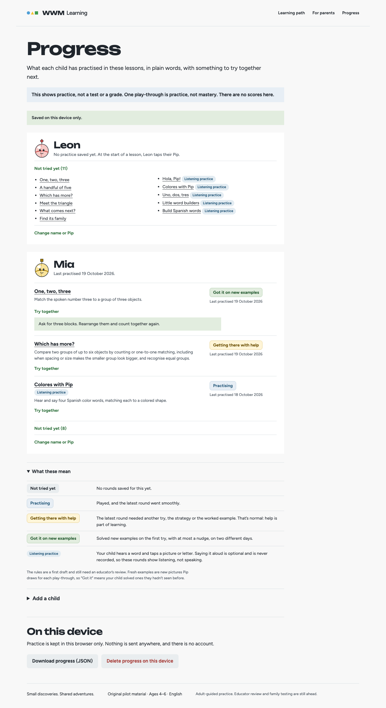
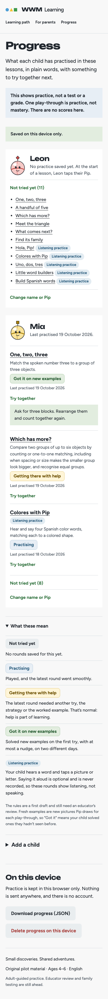

# Phase 31 M2: progress on the device

**Date:** October 19, 2026, about 22:50 to 23:25 PDT.
**Agent:** Claude Code (Claude Opus 5.5), a phase sub-agent in the worktree `p31-m2-device-progress` (branch `claude/p31-m2-device-progress`), working in parallel with M3.
**Plan:** [plans/phase-31-lesson-depth-and-tracking.md](../../plans/phase-31-lesson-depth-and-tracking.md), milestone M2. Design guidance: the impeccable skill and `apps/education/DESIGN.md`.

## Key instructions
- Deeper lessons and progress a grown-up can read on this device, with no account. The child's screen stays as simple as today; only the parent area grows.
- Implement `ProgressStore` (contract in `@wwm/learning` `sync.ts`) over IndexedDB, turn on fresh examples for the four generated objectives, have the lesson page play `expandActivity` and record `roundEvidence` per solved round, add a picture-only profile picker and a held "who's playing" switch, and add a Progress page with profiles, plain-language states, export and deletion.
- No analytics, no network calls with child data, no accounts (M3), no productivity claims.

## What changed (N: new, not a 2013 feature)
- **Store (N):** `packages/learning/src/browser-store.ts`, `createBrowserStore(name = 'wwm-learning-progress')`. IndexedDB version 1 with `profiles`, `events` (index `profile`), `outbox` (index `profile`) and `meta`. Each method is one transaction. `appendEvidence` validates with `evidenceSchema` and writes the event and its outbox entry together, idempotent by id (a re-append after sync doesn't re-queue). `deleteProfile` also removes that child's events, outbox entries and active-profile mark; `clear` removes everything. Failed opens reject and are retried on the next call.
- **Fresh examples on (N):** `baseline.ts` gives every activity with a bank (`count-three`, `count-five`, `compare-groups`, `spanish-colors`) `fresh: { objective: <its id>, count: 2 }`.
- **Lesson page (N):** plays `expandActivity(path, activity, { seed, seen })`, with `seen` from the child playing (empty with none). With a child chosen, each newly solved round appends `roundEvidence` with `surface: 'lesson'`, the input actually used (a direct button press counts as a tap) and the time since the round started. "Play again" draws again, so fresh examples the child has met are skipped. Without IndexedDB, or without Web Crypto, the lesson plays as before and saves nothing.
- **Who's playing (N):** a picture-only picker of Pip avatars when two or more children exist. It is remembered for the browser tab; one child is chosen silently and none shows nothing. "Hi, <nickname>!" goes through browser speech only. The "Switch who’s playing" button under the lesson uses the game's press-and-hold gate (2 s, or hold G; `src/hold.ts`, ported from `apps/web/src/learning/HoldButton.tsx`). Avatars are Pip in six colours, each with a different shape on an antenna, so they don't depend on colour.
- **Progress page (N):** `/progress/` (`src/progress.ts`, `src/progress-render.ts`), linked from the header and behind the same gate. It shows:
  - "This shows practice, not a test or a grade." and "Saved on this device only."
  - Per child: practised objectives (most recent first) with the plan §3 copy, the last practised date in the family's time zone, Try together and listening-practice tags; then "Not tried yet (n)"; then edit and delete.
  - "What these mean"; add a child (nickname help text, Pip picture radios); "Download progress (JSON)"; and "Delete progress on this device" with an inline confirmation.
  - `#account-slot`, kept for M3.
- **Smaller changes:** lesson summaries count fresh rounds ("7-round challenge" for `compare-groups`); the grown-up notes say "Then two new examples."; DESIGN.md documents the picker, the gate, the Progress page and the new tokens (danger, state outlines, pill radius).
- **Docs:** [docs/education/progress-tracking.md](../education/progress-tracking.md); `apps/education/README.md`.

## Screenshots
| | Desktop (1440 px) | Mobile (390 px) |
| --- | --- | --- |
| Picker (two children) |  |  |
| Progress after scripted play |  |  |

The child-surface screenshots change only where the plan expects: the picker, plus the extra planks and rounds the fresh examples add to the bridge.

## Attempts that failed
- `saveProfile` and `appendEvidence` first threw validation errors synchronously instead of rejecting; they are now `async`.
- The first Progress e2e lost one event: the test navigated straight after the final answer, before the IndexedDB write committed. The test now waits for the write; the narrow window is noted under remaining defects.
- An assertion that written rounds never reach browser speech failed: when a quick tap interrupts a clip, the voice player falls back to speech (the known double-fallback noted in the existing e2e). The test now checks only that fresh lines, which have no clips, are spoken by the browser and that clips were requested for the rest.
- Avatar radio cards cover their label with the real input, so Playwright's text click was intercepted; tests check the radio by role.

## Manual interventions
None.

## Test evidence
- `pnpm vitest run --project @wwm/learning`: 85 tests, including 7 store tests with `fake-indexeddb` (profiles, active profile and token across instances, idempotent append with outbox, schema rejection, complete per-profile deletion, export and clear, unavailable IndexedDB).
- `pnpm vitest run --project @wwm/education pages`: 22 tests, including fresh notes and summaries, hidden picker markup, distinct avatar shapes, hold-button names, Progress copy and slot, states and ordering, escaping and time-zone days.
- `WWM_EDUCATION_E2E_BASE=… pnpm vitest run --project @wwm/education education.e2e` against `vite preview` of the built site: 29 Chromium tests pass. The existing 20, updated for fresh rounds, still pass. New tests:
  - no profiles
  - one profile, desktop and mobile: evidence per round, `after-retry`/1, `first-try`/3 and `first-try`/0, items, input, outbox; "Play again" draws unseen items
  - two profiles, desktop and mobile: picker, browser-speech nickname, the whole lesson with fresh rounds before the bonus, the held switch, a new tab asks again
  - Progress, desktop and mobile: gate, validation, add, rename, recolour, states after play over two days with `page.clock`, export, then delete one child and everything
  - fresh-round lines through browser speech
  - no IndexedDB (missing, and `open` throwing)
- `pnpm vitest run --project @wwm/web learning`: 54 tests, including the Chromium Pip-gate e2e. The game still plays the written rounds; it ignores `fresh` until M5.
- `pnpm check`: green after `pnpm docent:index`.

## Remaining defects
- An evidence write still in flight when the page unloads (for example, leaving within milliseconds of the last answer) can be lost. Writes take a few milliseconds.
- `docs/education/html-contract.md` still says no activity requests fresh examples yet. That file isn't M2's to edit.
- `packages/learning/README.md` doesn't list `createBrowserStore` yet. That file isn't M2's to edit.
- Thresholds and parent copy still need an educator's review. Child usability and parent comprehension are human gates.
