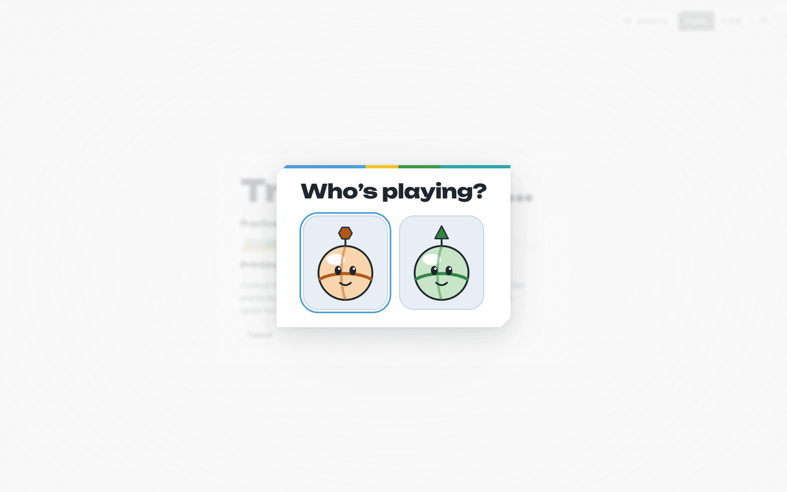
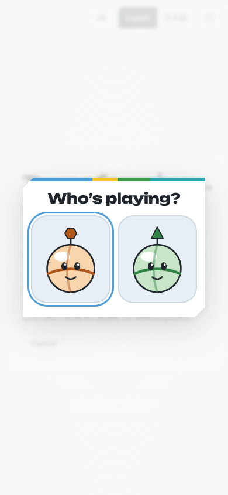

# Phase 31 M5: the maze records the same learning evidence

**Date:** October 19, 2026, about 23:25 to 00:20 PDT.
**Agent:** Claude Code (Claude Opus 5.5), a phase sub-agent in the worktree `p31-m5-maze-evidence` (branch `claude/p31-m5-maze-evidence`).
**Plan:** [plans/phase-31-lesson-depth-and-tracking.md](../../plans/phase-31-lesson-depth-and-tracking.md), milestone M5. Builds on [M2](phase-31-m2.md).

## Key instructions
- A lesson played in the maze records the same `LearningEvidence` as the lesson page (`surface: 'maze'`), in the same device store. Fresh examples play in the maze too. The child-facing game must not get more complicated.
- Use the M2 rules for who's playing: nothing with no children, one child chosen silently, and a picture-only Pip picker for two or more unless a child was picked in this tab. Build the picker in the game's React UI, draw the avatars like M2 does, and speak nicknames only with browser speech.
- Falls, respawns, maze score, time and missions must never produce or change evidence. Fail soft without IndexedDB. Learning runs stay unranked. Make no analytics or network calls with child data.
- No productivity claims.

## What changed (N: new, not a 2013 feature)
- **Fresh examples in the maze (N):** `LearningGates.ready()` (`apps/web/src/learning/gates.ts`) settles who's playing, reads their `seenItems`, and plays `expandActivity(path, activity, { seed, seen })`. The seed is the play-through's seed, so the e2e `learningSeed` pins it. `game.ts` `#loadSlice` starts `ready()` alongside the stage build and waits for it before decorating the stage. That's the only change to `game.ts`. Each new game (`resetProgress`) draws again. A draw finished for an older play-through is dropped.
  - Levels with `steps: 'rounds'` (Explore, Gated, Goal only) gain a gate per fresh round. With fresh examples, `compare-groups` has 9 rounds but 6 required ones, so it has 6 steps. On the practice stage its 4 written steps bind exactly as before (r1 to r3 behind bridge or lift cuts, r4 keeping the finish shut), and `fresh-1` and `fresh-2` also keep the finish shut. Every baseline lesson is within `MAX_STEP_SPOTS = 8`; the most is 6 (`compare-groups`, `spanish-colors`).
  - With more required steps than spots, the overflow rounds have no gate. `needsStartCard()` asks the first of them on the "Before you roll" card at each stage start, and any gate whose own step is done asks the next pending round. A unit test with 8 written required rounds and 2 fresh ones shows `fresh-1` asked on the start card and recorded. Fresh examples then come before some written rounds; no current lesson hits this.
  - Explicit step lists (the `mission` levels) leave fresh rounds out, by design.
- **Who's playing (N):** `apps/web/src/learning/players.ts` has `choosePlayer`, `listPlayers` (2.5 s timeout), `PICKED_KEY`, `confirmPick` and `speakNickname`, ported from `apps/education/src/profiles.ts` and `lesson.ts`. It uses the same store (`createBrowserStore()`, IndexedDB `wwm-learning-progress`) and the same sessionStorage key, so a pick on the lesson page holds in the game in the same tab, and the other way round.
- **Picker (N):** `LearningPicker.tsx`, mounted once in `Screens.tsx`. It's a modal dialog over the building screen with one big button per child (at least 136×150 px, 152×172 px on desktop), drawn with the M2 avatars and named by nickname for assistive technology. The first Pip takes focus; arrows and Tab move between Pips, and Enter, Space, tap or click picks. It respects `prefers-reduced-motion`. "Hi, <nickname>!" uses browser speech only, and not when the game is muted.
- **Grown-up line (N):** the select screen's Pip gates panel says "Saving practice for <nickname> on this device." With two or more children it adds **Switch who's playing** (press and hold 2 s, or hold W; G stays the level control's key). The switch shows the picker straight away and starts a new play-through for the child picked.
- **Avatars:** `apps/web/src/learning/avatars.ts` ports `AVATAR_LOOKS` and `avatarSvg` from `apps/education/src/profiles.ts`. A unit test checks that the port's markup is byte-identical for every avatar. CCR-31-5 below proposes one shared copy.
- **Evidence (N):** `answer(choice, mode)` is the only place evidence is made. When a round becomes solved, `#record` calls `roundEvidence({ …, surface: 'maze', input: mode, durationMs })` and queues `appendEvidence`; a failed write is counted and dropped. Inputs:
  - `tap`: a click or tap on a choice
  - `letter-key` and `number-key`: those keys
  - `arrows`: Enter or Space on the cursor, or a gamepad's JUMP
  - `tilt`: a paired phone's JUMP

  The duration runs from when the round appeared on the card: when the card opened, or when a follow-up or an accepted bonus round replaced the last one. The maze is paused while the card shows. Nothing is recorded without a child, before `ready()` has drawn the play-through (origins are empty), or without Web Crypto (`expandActivity` can't hash, so the written rounds play).
- **i18n:** `learning.picker.title` and `learning.player.{saving,switch,switchHint}` in `en` and `ja`.
- **Debug state:** `learning.rounds`, `learning.fresh`, `learning.player` (`none`, `chosen` or `asking`) and `learning.evidence` (`saved`, `unsaved`). There's no profile id or nickname.
- **Docs:** the "Maze" section of [docs/education/progress-tracking.md](../education/progress-tracking.md).

## Screenshots
| Desktop (1440 px) | Mobile (390 px) |
| --- | --- |
|  |  |

Taken by `WWM_M5_SHOTS=1 pnpm vitest run apps/web/test/learning-evidence.e2e.test.ts`. The picker is over the building screen of `/play/practice?learn=compare-groups`. The first Pip has keyboard focus.

## Contract Change Request
**CCR-31-5 (proposed): share the avatar drawing.** Move `AVATAR_LOOKS` and `avatarSvg(theme, avatar, size, className?)` from `apps/education/src/profiles.ts` into `@wwm/learning` (for example `avatars.ts`, next to `AVATARS` in `sync.ts`). Both apps would import it; it's additive and needs no schema change. Until then, `apps/web/src/learning/avatars.ts` is a port with a comment, and `test/learning-evidence.test.ts` fails if the two drift.

## Attempts that failed
- After an `await`, TypeScript still narrowed `#asking` to `null` from an earlier check (`Property 'done' does not exist on type 'never'`). A small getter reads it fresh.
- Biome's accessibility rules rejected a `role="group"` wrapper with a key handler. The arrow and Tab handling moved onto the avatar buttons.
- In unit tests, fake-indexeddb needs `IDBKeyRange` stubbed as well as `indexedDB`. Without it, `seenItems` failed and was caught, so fresh examples were silently drawn for an empty `seen` set. The tests now stub both.
- Sorting events by their UUIDv7 id didn't give play order: with the test clock pinned they share a millisecond, and the random bits decide. Tests sort by round order.
- `page.evaluate` with a dynamic `import()` was rewritten by Vitest (`__vite_ssr_dynamic_import__ is not defined`). The e2e passes the store import as a script string.
- Leaving play through the title screen didn't come back through "pairing" as expected. The e2e uses the pause menu's "another site" instead.
- The existing e2e "a downloaded learning page…" expected `count-three`'s only gate to lead to the finale. With two fresh examples it has three steps; the test now plays `fresh-1` and `fresh-2` at gates 2 and 3.

## Manual interventions
None.

## Test evidence
- `pnpm vitest run apps/web/test/learning-evidence.test.ts`: 21 tests over fake-indexeddb with the real `createBrowserStore`. They cover:
  - the player rules, including a store that never answers
  - avatar parity with apps/education
  - fresh rounds on `rounds` levels and their absence from `mission`, and a fresh round on its gate
  - re-drawing unseen items, and the overflow beyond 8 spots on the start card
  - per-input evidence: arrows after a retry with the match tool, a letter key, phone tilt and JUMP, a tap, a nudged number key on a follow-up
  - duration buckets from card time, and `objectiveProgress` reading the events
  - zero children, no IndexedDB, a failing store, and no Web Crypto
  - **the proof:** the same gate answers give identical events (minus random ids) whether or not the maze also sees every gem, a guarded hop, a pressed lock, a respawn or retry (`stageReady` again) and 250 s of maze time; a completed mission, a "Later" and the grown-up override record nothing; and a source check that `roundEvidence(` and `#record(` appear once each, inside `answer()`, and that the lesson side reads no fall, spare, score or timer
  - the picker: waits, ignores unknown ids, greets unless muted, remembers, records for the child picked, doesn't ask again in the tab, the switch asks again, and clearing the lesson closes it
- `pnpm vitest run apps/web/test/learning-evidence.e2e.test.ts` (Chromium, Vite dev server, `/api` mocked): 5 tests.
  - **One child:** no picker. r1 by keyboard after a retry, then `fresh-1` by tap, give 2 events (`surface: 'maze'`, `arrows`/`after-retry`/1 and `tap`/`generator`/fresh). `objectiveProgress` says `practising`, and the Progress page's own `childHtml` renders "Practising" for "Which has more?". Running the stage timer out leaves the events byte-identical, and the run stays unranked (`learningRun`).
  - **No children:** fresh rounds play, nothing is saved, and the store stays empty.
  - **Two children, desktop and 390 px:** the picker shows during building. The maze waits, avatars are sorted by nickname, targets are at least 120 px, and focus is on the first Pip. A child picks by keyboard (desktop) or tap (mobile), the events belong to them, and a new tab asks again. No request URL or body carries a nickname or profile id.
  - **Grown-up line:** no line before a pick; after one, "Saving practice for Leo on this device." A quick tap on the switch does nothing; a 2 s hold shows the picker, and picking Mia updates the line and the tab's pick.
- `pnpm vitest run apps/web/test/learning.e2e.test.ts`: 5 tests pass, including the updated `count-three` file test.
- `pnpm check`: see the hand-off. Green after `pnpm format`.

## Remaining defects
- The paired phone can't answer the picker; a grown-up or the child taps the screen or uses the keyboard. The gate card itself still works by tilt.
- The overflow fallback (more than 8 required steps) asks fresh rounds on the start card before some written rounds. No current lesson needs it.
- An evidence write still in flight when the page unloads can be lost, as in M2.
- `docs/education/html-contract.md` still says the game plays the written rounds until M5, and `apps/web/README.md` doesn't mention the picker. Neither file is M5's to edit.
- Thresholds, parent copy and child usability are still human gates (plan "Acceptance").

## Decisions for the owner
1. CCR-31-5: move the avatar drawing into `@wwm/learning`, or keep the tested port.
2. The picker appears while the maze builds, not on the site-select screen. A child picks right before play, and the grown-up who chose the lesson isn't asked. Confirm this placement.
3. Hold W for "Switch who's playing" in the game (G is taken by the level control). M2's lesson page uses G.
4. Fresh examples play in the maze with no child too (with an empty `seen` set), as on the lesson page.
