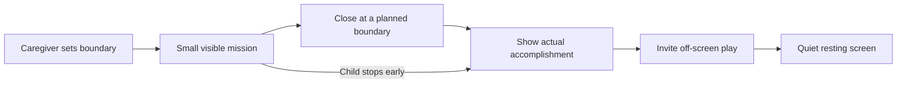

# Engaging play, supported stopping, and accomplishment for ages 3–6

Research date: October 28, 2026 (America/Los_Angeles).

Status: research and proposed product direction. No gameplay changes or child testing have been completed in this task. The current product primarily targets ages 4–6 with a grown-up; including age 3 is a proposed audience expansion that needs separate content and usability review.

## Decision and working assumptions

Build an experience children enjoy, understand, learn from, and can leave with support and a sense of completion. Treat successful stopping as part of the product outcome. The request's phrase about children being unable to step away is interpreted in light of its time-limit and wind-down goals as wanting children to remain able to disengage.

Confirmed setting: **child-led play, with a caregiver-set limit enforced by the game**. The caregiver configures and authorizes the session; ordinary instructions, help, transitions, and stopping must work without an adult operating each step. Caregiver support can remain available. Independent usability, especially for age 3, is a hypothesis to test rather than an established capability. Enforcement covers the game's own surfaces; a cross-device screen-time control is a different capability.

The central tension is between completion and a reliable time boundary. Requiring the child to solve one last problem can make the ending unpredictable, especially for a child who needs more help. Design an ending that acknowledges partial progress and never depends on correctness, a calm response, or finishing a ritual.

## What the evidence supports

### Regulation and interaction vary substantially within this age range

Harvard's guidance describes rapid development of executive function and self-regulation at ages 3–5, with younger children needing more support with rules and structure. Its ages 5–7 guidance still emphasizes wide differences in interest and skill, and challenges matched to the child. These are developmental guides, not trials validating our interface. [Harvard: ages 3–5](https://developingchild.harvard.edu/wp-content/uploads/2024/10/Executive-Function-Activities-for-3-to-5-year-olds.pdf), [Harvard: ages 5–7](https://developingchild.harvard.edu/wp-content/uploads/2024/10/Executive-Function-Activities-for-5-to-7-year-olds.pdf).

**Design interpretation:** provide a simpler supported entry and an optional more independent path. Adjust language, choices, motor demands, and adult support separately. Do not assign a fixed attention span or ability level from age alone. An absence of input can mean thinking, listening, a motor difficulty, distraction, or a wish to stop; it does not establish boredom.

### Educational engagement needs a learning goal

Hirsh-Pasek and colleagues' 2015 research synthesis proposes active, engaged, meaningful, and socially interactive learning around a supported learning goal. Repeated tapping and watching rewards do not by themselves meet that framework. It is a design framework, not evidence that an individual app teaches effectively. [Putting Education in “Educational” Apps](https://pubmed.ncbi.nlm.nih.gov/25985468/).

**Design interpretation:** let children count, compare, sort, predict, explain, and try strategies. Keep Pip's action tied to the concept. Invite a caregiver or an off-screen example. Assess a fresh example separately from the familiar practiced item.

### Predictable boundaries deserve priority over a more elaborate timer

Hiniker and colleagues interviewed 27 families and collected diaries from 28 different families with children ages 1–5. Routines and technology-supported stopping were associated with easier transitions; parental advance warnings were associated with harder transitions. Most recorded experiences were passive video, and the data were parent-reported and observational. This does not establish that warnings cause distress or that an in-game visual timer is harmful. [2016 CHI paper](https://media.wix.com/ugd/a0f093_d8ef5b72642c43279e3a2bc09187bd5b.pdf).

The AAP advises agreeing on limits and helping children reconnect with a caregiver. It explicitly acknowledges individual differences in whether warnings help. [AAP transition guidance](https://www.healthychildren.org/English/family-life/Media/Pages/screen-time-and-temper-tantrums-helpful-tips-for-parents.aspx).

**Design interpretation:** establish the ending before play, provide natural stopping opportunities, and test a quiet visual cue instead of assuming repeated warnings will help. Do not promise an end to meltdowns or pretend the device is broken.

### Design can create pressure to keep playing

A 2022 cross-sectional analysis of apps used by 160 children ages 3–5 identified character relationship pressure, fabricated time pressure, navigation constraints, and attractive lures. The study describes features and exposure; it does not measure the causal effect of removing each feature. [Radesky et al., JAMA Network Open](https://jamanetwork.com/journals/jamanetworkopen/fullarticle/2793493).

The AAP's January 2026 recommendations call for designs that support disengagement, disabled autoplay, and fewer features that prolong use. This replaces relying on older screen-time advice as the sole framework. [AAP's 2026 recommendations](https://www.healthychildren.org/English/news/Pages/creating-a-child-friendly-digital-world-AAP-releases-new-media-recommendations.aspx).

**Product decision:** omit streak loss, scarce rewards, surprise prize loops, guilt from Pip, looming unfinished collections, and automatic next adventures. These exclusions express the product's values; the cited studies do not establish a ranked list of causal harms.

### Motor demands can masquerade as learning difficulties

Vatavu and colleagues studied tap and drag interactions with 89 children ages 3–6, alongside 30 young adults. Performance improved with age and related to sensorimotor measures. This supports accounting for children's motor skills, but does not establish one universal CSS button dimension. The publisher's indexed abstract and excerpts were available; the full article could not be retrieved directly. [Touch interaction for children aged 3 to 6 years](https://doi.org/10.1016/j.ijhcs.2014.10.007).

**Design interpretation:** generous separated targets, stationary controls, one-tap actions, forgiving recovery, and alternatives to precise dragging or tilting. Do not record a missed touch or a failure to use a requested input method as a wrong conceptual answer.

### Feedback should provide usable information

A systematic review of 44 empirical papers on corrective feedback, covering approximately ages 3–11, found broad benefits relative to practice without feedback. Much of the evidence concerns immediate performance. Feedback forms, learner knowledge, age, and tasks differ; the review does not validate a universal retry threshold or prove one timing rule for preschoolers. [Fyfe and colleagues: developmental perspective on feedback](https://pmc.ncbi.nlm.nih.gov/articles/PMC10373990/).

**Design interpretation:** acknowledge the response promptly, show a relevant strategy, and offer increasing support. Test the exact hint ladder. Use a neutral tone and descriptions of the child's observed action. A worked example counts as supported practice, not independent mastery.

### Color should communicate clearly; learning must be checked beyond the screen

W3C guidance requires information beyond color alone when color conveys meaning. Pair states with shape, position, symbols, accessible names, and spoken or written information. This is an accessibility requirement, not a theory of preschool color psychology. [W3C: use of color](https://www.w3.org/WAI/WCAG22/Understanding/use-of-color.html).

The APA's September 2026 educational technology report distinguishes participation and completion from retained, transferable learning. Its stated audience is ages 5–18, so it directly overlaps only the older part of this proposed audience. [APA educational technology report](https://www.apa.org/pubs/reports/children-adolescent-learning-educational-technology).

**Evidence limit:** the material reviewed does not establish an optimal session length, an ideal hue or saturation, a validated sound-fade schedule, or that a particular wind-down reverses physiological arousal. Those require observation and testing. Avoid presenting “dopamine detox,” a universal attention-span formula, or “blue makes preschoolers calm” as explanations for these decisions.

## Proposed experience

This sequence and all numerical values below are starting hypotheses, not clinical recommendations or established developmental cutoffs.

Stop remains available during every phase. The recap and off-screen invitation can be skipped; leaving never requires an extra tap, answer, or successful performance. The resting screen must appear on its own if the child does nothing.

### 1. Agree on a small mission and the ending

- The caregiver chooses a time budget and optionally what comes afterward, then authorizes play. The child can choose from a small set of activities that fit the approved session. For a pilot, test one small mission within a **5–10 minute total budget**, selected by the caregiver. This range is an experimental starting point, not a daily allowance or an age-based prescription.
- Show and say the plan simply: “We'll help Pip with this bridge. Then we'll put the game away and find shapes in your room.”
- Use a stable, small picture of the planned work. Keep progress earned so far visible. Never extend the apparent finish by silently adding fresh examples or a bonus.
- Begin with two large response choices for a supported entry; offer additional complexity when appropriate. These are prototype choices to validate, not age tests.

### 2. Make progress finite and meaningful

- Keep the bridge/plank relationship: a child sees a consequence of their actual action. Use one brief relevant animation and a short explanation rather than several simultaneous rewards.
- Alternate a question with time to inspect, count, listen, or talk. Do not demand speed for conceptual practice.
- Give a recognizable stopping opportunity after each short unit. No automatic next lesson. Fresh examples remain valuable, but their count must be part of the agreed mission or deferred.
- Keep both “Help me” and an icon-supported “All done” visible. Use a neutral label for stopping; do not call it failure, quitting, or losing a reward.

### 3. Use a finite corrective loop

For a counting round, a candidate sequence is:

1. A wrong conceptual answer: “Let's count each one,” with a single visual indication of what to count.
2. Another difficulty: demonstrate one-to-one counting, then invite the child to try alongside Pip.
3. Offer “Show me with Pip” or “Save this for later.” “Show me” provides a modeled example without requiring an adult. A child can leave at any step. An additional “Ask my grown-up” option can be available without blocking progress or exit.

The number of attempts is a trial parameter, not a scientific threshold. Help is available immediately without deliberately answering incorrectly. If a worked example is used, save it as supported practice. Do not reward incorrect tapping with a more entertaining sequence than the learning task, or require repeated failure to obtain support.

Long explanations, repeated wrong-answer sounds, shaking controls, loss of previously earned bridge pieces, and compulsory correction before exit work against this proposed experience. Correct an idea without judging the child.

### 4. Treat the family limit separately from the game's clock

- A **session policy** determines when this family visit ends across lessons, maze gates, menus, and replay. A **gameplay clock** measures a game challenge. Stopping the gameplay clock must not silently remove the family boundary.
- Proposed first contract: the selected budget includes the ending. Reserve a short closing interval, initially around **45–60 seconds**, within that budget. That interval is a maximum, never a required amount of additional screen time.
- As closing approaches, do not start another bonus, generated round, new level, or portal trip. Finish at a nearby safe point if available; otherwise checkpoint the actual state. At the deadline, pause safely and show the quiet saved-state ending even if the current question is unresolved.
- Do not say “one last question” unless it truly fits. Correctness and motor speed cannot be prerequisites for stopping. Explain the boundary honestly: “Our playtime is finished. We can keep this for another time.” Only promise saving if saving succeeded.
- Show a quiet, non-pulsing progress cue if the child benefits from it. Keep exact minutes available to the caregiver. A cue should not turn red, beep repeatedly, or make the last minute feel like an emergency.
- Let the caregiver end immediately. Increasing a budget or starting another session requires a caregiver action, without advertising that extension to the child.

Before implementation, define refresh, route navigation, browser Back, new tabs, profile switching, lost storage, and background-tab behavior. A client-only timer or a press-and-hold gate cannot guarantee cross-device enforcement or tamper resistance. If storage fails, provide an honest caregiver-visible fallback instead of claiming a saved or enforceable limit.

### Child-led enforcement contract

The user's setting choice establishes responsibility for enforcement. The following are proposed implementation requirements, not existing behavior:

- **One authorization, one session:** opening another lesson, replaying, changing maze modes, or refreshing does not create a new allowance. The first prototype uses a per-session budget; a recurring schedule or daily quota remains a separate decision.
- **An explicit deadline:** start the agreed budget when authorized play begins. As an initial policy, pauses, hints, menus, and backgrounding do not move the deadline. On returning from a suspended or hidden page, check expiry before accepting input, starting speech, or resuming motion. This elapsed-time policy must be explained in caregiver settings.
- **A bounded closing phase:** begin closing before the deadline. At expiry, pause the game safely, prevent further play, and show a truthful recap followed by a resting screen. Neither a solved answer nor an acknowledgment tap is required. A lesson that finishes early can close early.
- **The child can always stop:** “All done” immediately stops active play and starts a skippable ending. If an unfinished session is resumed before its original deadline, it retains that deadline; it never receives a fresh budget.
- **The caregiver controls extensions:** after expiry, another session or extra time requires a deliberate caregiver unlock. Reuse the existing parent-account capability where appropriate after checking its authorization path. The current two-second hold is suitable for reducing accidental navigation, not authenticating an adult. Avoid child-visible “earn more time” or “ask for five more minutes” prompts.
- **Consistent state across surfaces:** persist the authorization and session state independently from a lesson's score or completion. Coordinate same-origin tabs so each observes the same session. Check the boundary at the game action entry points as well as in the UI. Cross-origin or multi-device coordination requires an explicit shared authority and is outside the first prototype unless added to scope.
- **Honest recovery:** if an established authorization cannot be recovered or validated, return to caregiver setup before allowing more play. Keep exit and the quiet ending available. Local-only storage cannot survive deliberate clearing as an authoritative control; stronger enforcement requires an authenticated source of session state.
- **A self-contained child flow:** speak essential directions, show recognizable pictures, offer replay and modeled help, and never depend on reading or an adult's response to finish the session. Offer off-screen invitations that can begin independently where appropriate, such as spotting shapes nearby; caregiver involvement remains optional for the handoff and available when needed.

Acceptance scenarios: expire during an unresolved question, a hint, a maze movement, and a completion animation; then verify replay, refresh, Back, another tab, and profile switching retain the boundary. Test background suspension past expiry and failed storage. Verify that a caregiver can authorize another session, while ordinary child navigation cannot. These functional checks complement family observation; they do not establish that every child can independently use the product.

### 5. Close with truthful accomplishment and an easy handoff

- Reduce competing activity: stop ambient bouncing and decorative loops, keep important instructional sound clear, and let music settle if music is present. Do not rely on a palette change or sudden darkening as a treatment for arousal.
- Optional closing action: Pip rolls to a resting place. No precision task, speed requirement, or reward multiplier. A child who walks away should not miss a required completion action.
- Describe only what happened: “You counted two groups and tried matching them.” After modeled practice: “We counted together.” An interrupted bridge remains the bridge actually built; do not fabricate completion or a perfect score.
- Bring the existing off-screen activity into the child-facing ending, with a simple independent option such as “Look around. Can you spot a triangle?” and an optional shared activity such as finding three blocks together. These are invitations, not final scored questions. The caregiver can select safe, accessible alternatives during setup.
- End with a still screen and a neutral message such as “Playtime is finished.” No next-level teaser, countdown to return, replay lure, or sad Pip. Preserve a bookmark when possible, without saying Pip is waiting or needs the child to come back.

## Buttons, color, sound, and movement: initial design constraints

| Area | Proposed starting point | What to observe |
| --- | --- | --- |
| Touch targets | Prototype primary child actions at roughly 64–80 CSS px with 12–16 px separation; enlarge the effective hit area without overlap. Test on actual phones and tablets: CSS px do not guarantee a physical finger-sized target. | Misses, neighboring hits, reach, accidental activation; resize when needed. |
| Choice layout | Stationary, separated choices; one main instruction. Randomize the answer arrangement between rounds if useful, then hold it stable during attempts and hints. | Does the child understand the task, or merely follow a location or visual cue? |
| Color roles | Preserve the current palette and use a quiet background with clear action contrast. Keep answer choices equally prominent. Keep help and stop readable and easy to reach. | Does a bright button accidentally reveal an answer or hide an exit? |
| Semantic states | Pair color with a check, illustration, spoken cue, or text. For a color-learning task, adult descriptions remain available without revealing the answer prematurely. | Can the child use the interface with color-vision differences and audio muted? |
| Instruction | Short, concrete spoken prompt with replay and visible equivalent; no reading prerequisite for essential child controls. | Comprehension, language fit, audio reliability, caregiver help. |
| Input | Tapping is sufficient for conceptual answers; dragging and tilting are optional alternatives or separately taught skills. | Distinguish motor errors from concept errors; account for alternative access. |
| Motion | One relevant motion at a time; stop decorative loops during thinking and closing; honor reduced motion. | Does movement help the child understand or repeatedly pull attention elsewhere? |
| Sound | Avoid stacked voices and effects; allow mute and replay. Give a quiet acknowledgment without escalating loudness or reward intensity. | Startle, repeated replay, missed instructions, individual sensory preferences. |

These sizes, gaps, pacing choices, and control counts are proposed usability parameters. Brightness is not a diagnosis of overstimulation, and a quieter screen does not prove the child is calmer.

## Findings in the current WWM source

Reviewed the local checkout on the research date, not a hosted deployment.

| Current behavior | Owning source | Proposed consequence |
| --- | --- | --- |
| Shared `intro → round → bonus-offer → done` flow; wrong answers climb hints; solved rounds lock; helped rounds can introduce follow-ups | `packages/learning/src/session.ts` | Preserve useful teaching behavior; add a separate session boundary that can end or checkpoint any lesson state. Additional help must not extend the family budget. |
| Required rounds determine the bridge; selected activities add fresh examples before the bonus | `apps/education/src/lesson.ts`, `apps/education/README.md` | Freeze mission scope before play or defer extra examples. Do not lengthen the visible finish as a reward for playing. |
| End card says the whole bridge is built, makes Next activity primary, offers Play again, and puts the offline activity below these controls | `apps/education/src/render.ts` | Add a separate session-ending view with truthful partial-progress copy and an off-screen handoff as the focal action. |
| Choice targets have a 44 px minimum; main Next is 64 px on desktop and 56 px on mobile; Pip has an ambient bob; reduced motion is supported | `apps/education/src/style.css` | Measure actual touch behavior and responsive hit areas; expand controls when needed; use quiet/resting state controls for motion. |
| Game-side lessons share the round rules; the game owns pause and timer; its completion card offers rolling onward | `apps/web/src/learning/gates.ts`, `apps/web/src/learning/LearningGateCard.tsx` | Route lesson and maze continuations through the same session policy. A family limit must remain effective while the game is paused for teaching. |

Existing learning records already distinguish help. Session ending, an incomplete question, timeout, and a touch miss must not become evidence of a conceptual mistake or independent mastery. The current docs have drift about accounts and storage; any implementation should inspect the actual owning code rather than treating older product notes as current capability proof.

## Cheapest useful validation

Start with one counting lesson and one maze segment, reviewed by an early-childhood educator. Compare a simple boundary-and-saved-state ending with the proposed story-based closing and recap. Keep the same caregiver-set budget, content, and existing stop access in both. Do not expose children to manipulative mechanics to form a control group.

Recruit a small formative set, for example 6–8 consenting caregiver–child pairs spanning younger and older children, varied input experience, and relevant sensory/access needs. This can uncover obvious problems; it cannot estimate population effects or validate an “average child” design. Obtain caregiver consent and the child's willing participation; stop an observation when the child wants to stop or becomes distressed. A prototype session must not be prolonged for the study.

Observe a few ordinary sessions per family. The caregiver completes setup and stays available, while the child operates the game; record every adult intervention instead of silently treating assisted use as independent. Counterbalance order when comparing variants, and record fatigue, hunger, time of day, prior familiarity, caregiver assistance, and which offline activity followed. Separate direct observations from caregiver interpretation.

Record only what this question needs:

- Whether the boundary was honored, including a worst-case unsolved question and attempted replay or refresh.
- Whether the child understood the planned ending and noticed a usable exit.
- Missed touches, misleading color cues, help required, and repeated correction loops.
- Time from the ending to disengagement; caregiver reminders; any visible protest and its duration, described without diagnosing the child.
- Whether the child could describe something they did, or recognize their work; a verbal response is optional.
- A fresh, informal off-screen example later or the next day, distinguishing independent and supported performance. One response does not establish mastery or efficacy.

Success means a reliable boundary, understandable controls, truthful accomplishment, acceptable caregiver effort, and promising learning transfer. Longer sessions, more clicks, perfect completion, and zero visible frustration are not standalone success measures. If the story closing adds screen time, confusion, dependency, or conflict, choose the simpler ending.

## Recommended first scope and remaining decisions

Prototype the session policy, always-available stopping, bounded hints, truthful end card, and off-screen handoff before a palette redesign or a larger reward system. Keep existing bridge and Pip assets. Use one shared session contract across lesson and maze surfaces, outside the round correctness rules.

The usage setting is settled: child-led play with a caregiver-set limit enforced by the game. Remaining decisions include the caregiver's preferred budget, whether a later version needs a daily quota or cross-device enforcement, how partial work is resumed in a newly authorized session, and what simpler content age 3 needs. The main hypothesis to test is whether a brief, predictable closing adds accomplishment and supports disengagement better than a simple saved-state ending under the same limit.
